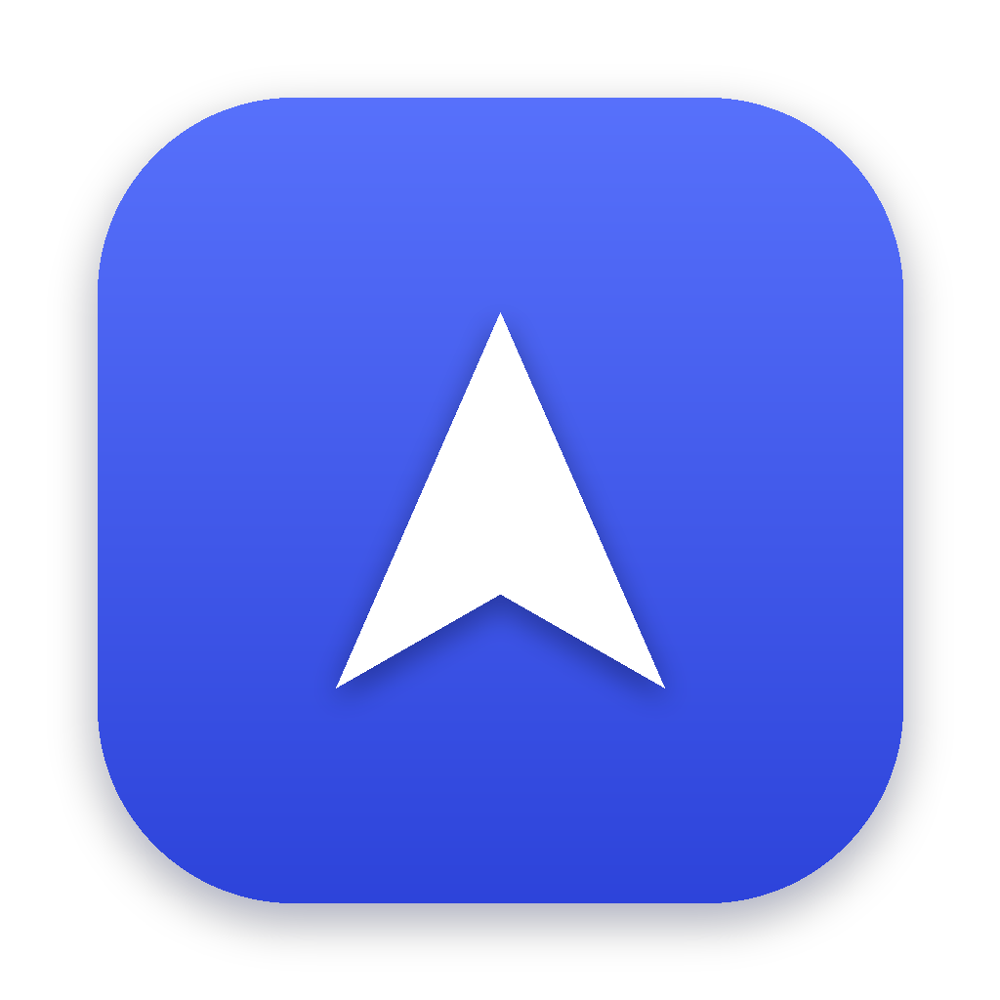

<p align="center">
  
</p>

<h1 align="center">JobPilot</h1>

<p align="center">
  Finds jobs in Germany that fit your CV, ranks them, writes tailored cover letters and sends your applications by email.<br>
  <b>Invite only:</b> you need a license key from the person who gave you JobPilot.
</p>

---

## Download

Get the newest version from **[Releases → Latest](../../releases/latest)**:

| Your computer | File |
|---|---|
| **Windows 10 / 11** | `JobPilot-…-Windows-Setup.exe` |
| **Mac with Apple chip** (M1, M2, M3, M4 · most Macs from 2021 on) | `JobPilot-…-Mac-AppleSilicon.dmg` |
| **Mac with Intel processor** | `JobPilot-…-Mac-Intel.dmg` |

Not sure which Mac you have? Apple menu  → **About This Mac**: it says either *Chip: Apple M…* or *Processor: Intel…*.

## Install on Windows

1. Double-click **JobPilot-…-Windows-Setup.exe**.
2. Windows may show **“Windows protected your PC”**. This appears because JobPilot is new and not yet signed with a paid certificate. Click **More info → Run anyway**.
3. Click **Install**. No administrator rights are needed.
4. JobPilot opens in its own window. Next time, start it from the **Start menu** or the desktop icon.

## Install on Mac

1. Double-click the **.dmg** file and drag **JobPilot** into **Applications**.
2. Open JobPilot from Applications. The first time, macOS says it can't verify the app. Click **Done** (not “Move to Trash”).
3. Open **System Settings → Privacy & Security**, scroll down and click **Open Anyway** next to JobPilot, then confirm with your Mac password.
4. If macOS instead says **“JobPilot is damaged and can't be opened”**, open the **Terminal** app, paste this line and press Enter, then open JobPilot again:
   ```
   xattr -dr com.apple.quarantine /Applications/JobPilot.app
   ```

You only need to do this once.

## First start

1. Enter your **license key** (looks like `JP-XXXX-XXXX-XXXX-XXXX`). It works on one computer.
2. Connect an **AI provider** with your own API key (DeepSeek, Gemini, Claude, OpenAI and more; JobPilot shows where to get one).
3. Upload your **CV**.
4. Connect your **email** (optional, needed to send applications; for Gmail use an app password).
5. **Find jobs.**

## Updating

Download the new version and install it over the old one. Your CV, jobs, letters and settings are kept.
JobPilot tells you inside the app when a new version is available.

## Your data

Everything stays on your computer:

- Windows: `%LOCALAPPDATA%\JobPilot\data`
- Mac: `~/Library/Application Support/JobPilot`

Only the text JobPilot needs is sent to the AI provider you chose, and applications go out from your own mailbox.

## Uninstall

- **Windows:** Settings → Apps → JobPilot → Uninstall.
- **Mac:** drag JobPilot from Applications to the Trash.

Your data folder stays until you delete it yourself.
